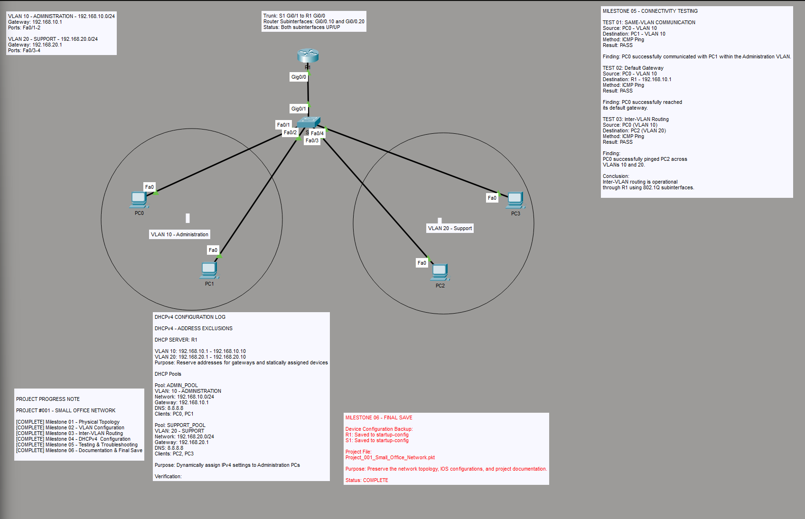

# Project 001: Small Office Network

## Project Overview

Designed and configured a small office network using Cisco Packet Tracer to support two departments: Administration and Customer Support.

This project demonstrates VLAN segmentation, 802.1Q trunking, router-on-a-stick inter-VLAN routing, DHCPv4 configuration, connectivity testing, and troubleshooting.

**Project Status:** Completed  
**Platform:** Cisco Packet Tracer

## Network Topology



### Network Devices

| Device | Model | Quantity |
|---|---|---|
| Router | Cisco 2911 | 1 |
| Switch | Cisco 2960 | 1 |
| Workstations | PCs | 4 |

## VLAN and IP Addressing Plan

| Department | VLAN | Network | Default Gateway | Switch Ports |
|---|---|---|---|---|
| Administration | 10 | 192.168.10.0/24 | 192.168.10.1 | Fa0/1–Fa0/2 |
| Customer Support | 20 | 192.168.20.0/24 | 192.168.20.1 | Fa0/3–Fa0/4 |

The switch connects to the router through S1 GigabitEthernet0/1 and R1 GigabitEthernet0/0.

## Configuration Summary

### 1. VLAN Configuration

Created VLAN 10 for Administration and VLAN 20 for Customer Support on S1.

Configured the corresponding PC-facing switch interfaces as access ports and assigned them to their respective VLANs.

### 2. Trunk Configuration

Configured S1 GigabitEthernet0/1 as an 802.1Q trunk to carry traffic for both VLANs.

Verification command:

`show interfaces trunk`

### 3. Router-on-a-Stick

Configured router subinterfaces for inter-VLAN routing.

**VLAN 10 subinterface:**
```
interface GigabitEthernet0/0.10
 encapsulation dot1Q 10
 ip address 192.168.10.1 255.255.255.0
```

**VLAN 20 subinterface:**
```
interface GigabitEthernet0/0.20
 encapsulation dot1Q 20
 ip address 192.168.20.1 255.255.255.0
```

Verified both subinterfaces were operational using `show ip interface brief`.

### 4. DHCPv4 Configuration

Configured R1 as the DHCPv4 server for both departments.

Reserved addresses .1 through .10 in each subnet for infrastructure and static assignments.

```
ip dhcp excluded-address 192.168.10.1 192.168.10.10
ip dhcp excluded-address 192.168.20.1 192.168.20.10

ip dhcp pool ADMIN_POOL
 network 192.168.10.0 255.255.255.0
 default-router 192.168.10.1
 dns-server 8.8.8.8

ip dhcp pool SUPPORT_POOL
 network 192.168.20.0 255.255.255.0
 default-router 192.168.20.1
 dns-server 8.8.8.8
```

All four workstations successfully received DHCP-assigned IPv4 addresses in their respective VLAN subnets.

## Connectivity Testing

| Test | Source | Destination | Result |
|---|---|---|---|
| Same-VLAN Connectivity | PC0 (VLAN 10) | PC1 (VLAN 10) | PASS |
| Default Gateway Connectivity | PC0 | 192.168.10.1 | PASS |
| Inter-VLAN Connectivity | PC0 (VLAN 10) | PC2 (VLAN 20) | PASS |

All three tests were completed successfully using ICMP ping.

## Troubleshooting Experience

### Issue: Trunk Interface Not Operational

**Problem:** The switch trunk interface was configured as a trunk, but its operational state was down. The trunk did not initially appear in the output of `show interfaces trunk`.

**Investigation:** Inspected switchport operating modes and interface states on both the switch and router.

**Resolution:** Enabled the affected interfaces and restored connectivity between S1 and R1.

**Verification:** Confirmed S1 GigabitEthernet0/1 appeared as an operational trunk and that router subinterfaces were up/up.

**Lesson Learned:** A correctly configured trunk cannot forward traffic if the underlying physical link is down. Both administrative configuration and operational interface status must be verified.

## Key Skills Demonstrated

- Cisco IOS command-line configuration
- VLAN creation and access port assignment
- IEEE 802.1Q trunking
- Router-on-a-stick inter-VLAN routing
- IPv4 addressing
- DHCPv4 server configuration
- ICMP connectivity testing
- Network interface troubleshooting
- Technical documentation

## Project Files

- Cisco Packet Tracer project: `Project_001_Small_Office_Network.pkt`
- Network topology: `network-topology.png`

## Conclusion

Successfully designed, configured, documented, and tested a small office network supporting two separate departmental VLANs.

This project strengthened my understanding of Layer 2 switching, Layer 3 routing, DHCPv4 services, and systematic network troubleshooting.
