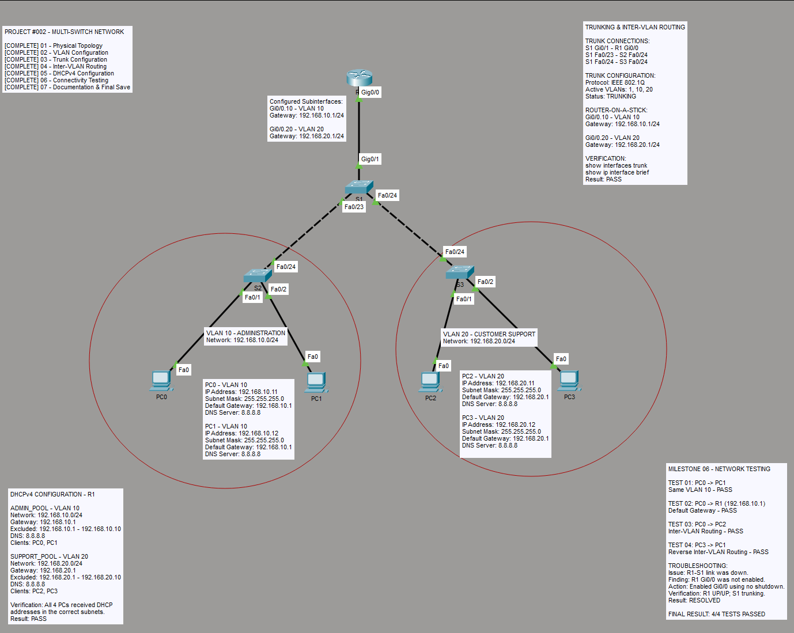

# Project 002: Multi-Switch Network

## Project Overview

Designed and configured a multi-switch office network using Cisco Packet Tracer to support Administration and Customer Support across two office areas.

This project expands on Project 001 by introducing multiple switches, switch-to-switch trunking, VLAN segmentation, router-on-a-stick inter-VLAN routing, DHCPv4, and systematic troubleshooting.

**Platform:** Cisco Packet Tracer  
**Status:** Completed

## Network Topology



### Network Devices

| Device | Model | Quantity |
|---|---|---|
| Router | Cisco 2911 | 1 |
| Switch | Cisco 2960 | 3 |
| Workstations | PCs | 4 |

### Physical Connections

| Device / Port | Connected To |
|---|---|
| R1 Gi0/0 | S1 Gi0/1 |
| S1 Fa0/23 | S2 Fa0/24 |
| S1 Fa0/24 | S3 Fa0/24 |
| S2 Fa0/1 | PC0 |
| S2 Fa0/2 | PC1 |
| S3 Fa0/1 | PC2 |
| S3 Fa0/2 | PC3 |

## VLAN and IP Addressing Plan

| VLAN | Department | Network | Default Gateway | Client Devices |
|---|---|---|---|---|
| 10 | Administration | 192.168.10.0/24 | 192.168.10.1 | PC0, PC1 |
| 20 | Customer Support | 192.168.20.0/24 | 192.168.20.1 | PC2, PC3 |

S1 serves as the central switch. S2 connects Administration workstations and S3 connects Customer Support workstations.

## Configuration Summary

### 1. VLAN Configuration

Created VLAN 10 (ADMINISTRATION) and VLAN 20 (SUPPORT) on S1.

Configured VLAN 10 on S2 and assigned Fa0/1 and Fa0/2 to VLAN 10.

Configured VLAN 20 on S3 and assigned Fa0/1 and Fa0/2 to VLAN 20.

Example access-port configuration:

```cisco
interface range FastEthernet0/1 - 2
 switchport mode access
 switchport access vlan 10
```

Verified VLAN membership using:

```cisco
show vlan brief
```

### 2. Trunk Configuration

Configured IEEE 802.1Q trunking between the central switch and both access switches, as well as the router-facing switch port.

Trunk connections:

- S1 Gi0/1 to R1 Gi0/0
- S1 Fa0/23 to S2 Fa0/24
- S1 Fa0/24 to S3 Fa0/24

Example switch-side configuration:

```cisco
interface GigabitEthernet0/1
 switchport mode trunk
```

Verified trunk operation using:

```cisco
show interfaces trunk
```

All three S1 trunk interfaces were verified as operational. VLANs 10 and 20 were active and allowed on S1's trunks.

### 3. Router-on-a-Stick Configuration

Configured R1 subinterfaces to provide Layer 3 routing between the two VLANs.

```cisco
interface GigabitEthernet0/0.10
 encapsulation dot1Q 10
 ip address 192.168.10.1 255.255.255.0

interface GigabitEthernet0/0.20
 encapsulation dot1Q 20
 ip address 192.168.20.1 255.255.255.0
```

Verified the physical interface and both subinterfaces were up/up using:

```cisco
show ip interface brief
```

### 4. DHCPv4 Configuration

Configured R1 to provide dynamic IPv4 addressing for both departments.

```cisco
ip dhcp excluded-address 192.168.10.1 192.168.10.10
ip dhcp excluded-address 192.168.20.1 192.168.20.10

ip dhcp pool ADMIN_POOL
 network 192.168.10.0 255.255.255.0
 default-router 192.168.10.1
 dns-server 8.8.8.8

ip dhcp pool SUPPORT_POOL
 network 192.168.20.0 255.255.255.0
 default-router 192.168.20.1
 dns-server 8.8.8.8
```

All four client computers successfully received DHCP addresses in their assigned subnets.

## Connectivity Testing

| Test | Source | Destination | Result |
|---|---|---|---|
| 01: Same-VLAN | PC0 | PC1 | PASS |
| 02: Default Gateway | PC0 | R1 (192.168.10.1) | PASS |
| 03: Inter-VLAN | PC0 | PC2 | PASS |
| 04: Reverse Inter-VLAN | PC3 | PC1 | PASS |

All four planned ICMP connectivity tests passed.

## Troubleshooting Experience

### Issue: Router-to-Switch Trunk Not Operational

**Symptoms:** S1 Gi0/1 was configured as a trunk but did not appear in the operational trunk table. R1 Gi0/0 reported down/down.

**Investigation:** Examined switchport mode, interface status, and the physical connection between S1 and R1.

**Resolution:** Enabled R1 Gi0/0 using the `no shutdown` command.

**Verification:** R1 Gi0/0 changed to up/up, the physical link became operational, and S1 Gi0/1 appeared as trunking.

**Lesson Learned:** Configuring an interface as a trunk does not guarantee operational connectivity. Both ends of the physical link must be operational, and administrative and operational status should be checked separately.

## Technical Skills Demonstrated

- Cisco IOS CLI configuration
- Multi-switch network topology design
- VLAN creation and access port assignment
- IEEE 802.1Q trunking
- Router-on-a-stick inter-VLAN routing
- DHCPv4 server configuration
- IPv4 addressing and subnetting
- ICMP connectivity verification
- Network interface troubleshooting
- Technical documentation

## Project Files

- [Cisco Packet Tracer Project](Project_002_Multi_Switch_Network.pkt)
- [Network Topology Screenshot](network-topology.png)

## Conclusion

Successfully configured and verified a multi-switch office network supporting two departments in separate VLANs.

This project reinforced my understanding of Layer 2 forwarding, trunk links, Layer 3 routing, DHCPv4, and systematic troubleshooting across interconnected Cisco devices.

