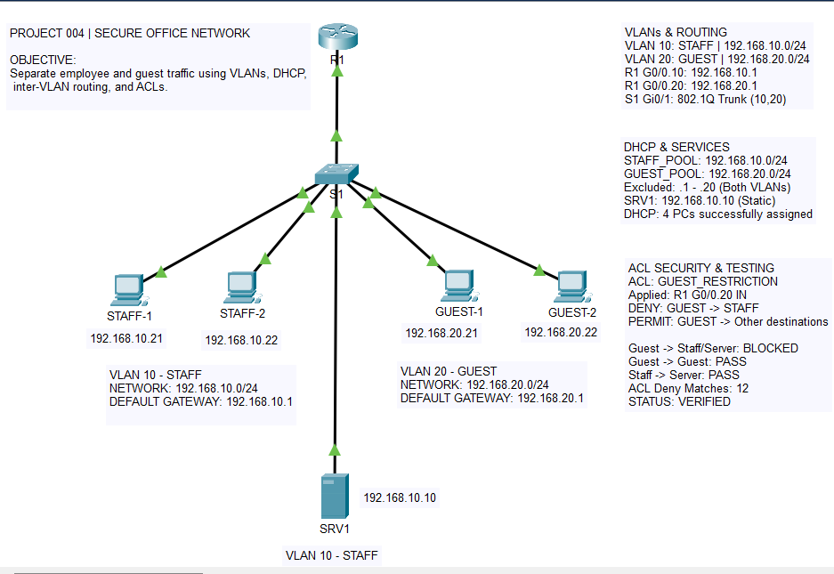

# Project 004: Secure Office Network & Extended ACLs

## Project Overview
Designed and configured a secure small office network using a Cisco 2911 router, a Cisco 2960 switch, four workstations, and one internal server in Cisco Packet Tracer.

Implemented VLAN segmentation, IEEE 802.1Q trunking, router-on-a-stick inter-VLAN routing, DHCPv4, and an extended access control list (ACL) to restrict guest access to internal employee resources.

Verified network connectivity, DHCP address assignments, ACL enforcement, and traffic filtering through ICMP testing and Cisco IOS verification commands.

## Network Topology


### Network Devices
- 1 Cisco 2911 router (R1)
- 1 Cisco 2960 switch (S1)
- 2 employee workstations (STAFF-1, STAFF-2)
- 2 guest workstations (GUEST-1, GUEST-2)
- 1 internal server (SRV1)

### Physical Connections

| Source | Interface | Destination | Interface |
|---|---|---|---|
| R1 | Gi0/0 | S1 | Gi0/1 |
| S1 | Fa0/1 | STAFF-1 | Fa0 |
| S1 | Fa0/2 | STAFF-2 | Fa0 |
| S1 | Fa0/3 | GUEST-1 | Fa0 |
| S1 | Fa0/4 | GUEST-2 | Fa0 |
| S1 | Fa0/5 | SRV1 | Fa0 |

## VLAN and IP Addressing

| Device | VLAN | IPv4 Address | Default Gateway | Method |
|---|---|---|---|---|
| STAFF-1 | 10 | 192.168.10.21 | 192.168.10.1 | DHCP |
| STAFF-2 | 10 | 192.168.10.22 | 192.168.10.1 | DHCP |
| GUEST-1 | 20 | 192.168.20.21 | 192.168.20.1 | DHCP |
| GUEST-2 | 20 | 192.168.20.22 | 192.168.20.1 | DHCP |
| SRV1 | 10 | 192.168.10.10 | 192.168.10.1 | Static |

### VLAN Information
- VLAN 10: STAFF
- VLAN 20: GUEST
- STAFF subnet: 192.168.10.0/24
- GUEST subnet: 192.168.20.0/24
- Subnet mask: 255.255.255.0

## Switch Configuration

### VLAN Configuration (S1)
```cisco
configure terminal
vlan 10
 name STAFF
vlan 20
 name GUEST
end
```

### Access Port Configuration
```cisco
configure terminal
interface range fa0/1-2
 switchport mode access
 switchport access vlan 10
exit
interface fa0/5
 switchport mode access
 switchport access vlan 10
exit
interface range fa0/3-4
 switchport mode access
 switchport access vlan 20
end
```

### Trunk Configuration
```cisco
configure terminal
interface gigabitEthernet0/1
 switchport mode trunk
 switchport trunk allowed vlan 10,20
end
```

Configured S1 Gi0/1 as an IEEE 802.1Q trunk to carry VLAN 10 and VLAN 20 traffic between S1 and R1.

## Router Configuration

### Router-on-a-Stick (R1)
```cisco
configure terminal
interface gigabitEthernet0/0
 no shutdown
exit
interface gigabitEthernet0/0.10
 encapsulation dot1Q 10
 ip address 192.168.10.1 255.255.255.0
exit
interface gigabitEthernet0/0.20
 encapsulation dot1Q 20
 ip address 192.168.20.1 255.255.255.0
end
```

Configured two router subinterfaces to provide default gateways and allow routing between VLAN 10 and VLAN 20.

## DHCP Configuration

### DHCP Address Exclusions
```cisco
configure terminal
ip dhcp excluded-address 192.168.10.1 192.168.10.20
ip dhcp excluded-address 192.168.20.1 192.168.20.20
end
```

Excluded the first 20 usable IP addresses from each DHCP pool to reserve addresses for gateways, servers, and other network infrastructure.

### DHCP Pool Configuration
```cisco
configure terminal
ip dhcp pool STAFF_POOL
 network 192.168.10.0 255.255.255.0
 default-router 192.168.10.1
exit
ip dhcp pool GUEST_POOL
 network 192.168.20.0 255.255.255.0
 default-router 192.168.20.1
end
```

### DHCP Verification
All four workstations successfully received IPv4 addresses from their assigned DHCP pools.

- STAFF-1: 192.168.10.21
- STAFF-2: 192.168.10.22
- GUEST-1: 192.168.20.21
- GUEST-2: 192.168.20.22

SRV1 was manually configured with the static IP address 192.168.10.10 and successfully communicated with its default gateway.

## Extended ACL Configuration

### Guest Network Security Policy
The company required guest devices to be restricted from accessing the internal employee network.

Created a named extended ACL called GUEST_RESTRICTION.

```cisco
configure terminal
ip access-list extended GUEST_RESTRICTION
 deny ip 192.168.20.0 0.0.0.255 192.168.10.0 0.0.0.255
 permit ip 192.168.20.0 0.0.0.255 any
exit
interface gigabitEthernet0/0.20
 ip access-group GUEST_RESTRICTION in
end
```

Applied the ACL inbound on R1 Gi0/0.20 to filter traffic originating from the guest VLAN.

### ACL Verification
Used `show access-lists` to confirm that the ACL was configured and actively filtering traffic.

The deny rule recorded **12 matches**, confirming that packets attempting to travel from VLAN 20 to VLAN 10 were blocked.

## Connectivity and Security Testing

| Source | Destination | Expected Result | Actual Result |
|---|---|---|---|
| GUEST-1 | SRV1 | Blocked | Failed |
| GUEST-1 | STAFF-1 | Blocked | Failed |
| GUEST-1 | GUEST-2 | Allowed | Success |
| STAFF-1 | SRV1 | Allowed | Success |

**Result:** All four tests produced the expected results, validating the configured security policy.

## Troubleshooting and Lessons Learned

### 1. Incorrect VLAN Assignment
During VLAN verification, S1 Fa0/5 was discovered in VLAN 1 instead of VLAN 10.

Used `show vlan brief` to identify the incorrect port assignment.

Reconfigured Fa0/5 as an access port assigned to VLAN 10 and verified the correction.

### 2. Spanning Tree Convergence
Initial trunk verification showed only VLAN 20 in the spanning-tree forwarding state.

After allowing STP time to converge, both VLAN 10 and VLAN 20 appeared in the forwarding state.

**Lesson Learned:** Allow spanning tree time to converge before assuming a VLAN forwarding issue exists.

### 3. DHCP Excluded Address Verification
The DHCP pool output displayed an unexpected excluded-address count.

Used `show running-config` to verify the configured excluded address ranges.

Confirmed that DHCP assigned workstation addresses starting at .21, outside the excluded ranges.

**Lesson Learned:** Verify both the running configuration and actual network behavior when troubleshooting unexpected command output.

### 4. ICMP Request Timed Out vs. Destination Unreachable
During ACL testing, observed different responses depending on which VLAN initiated communication.

**Guest-to-Staff Traffic:**
- GUEST-1 sent an ICMP Echo Request toward VLAN 10.
- The packet matched the inbound deny rule on R1 Gi0/0.20.
- The router blocked the traffic.
- The originating workstation received an unreachable indication.

**Staff-to-Guest Traffic:**
- STAFF-1 sent an ICMP Echo Request toward GUEST-1.
- The original request was permitted and forwarded.
- GUEST-1 attempted to send an ICMP Echo Reply.
- The reply entered R1 Gi0/0.20 and matched the deny rule.
- STAFF-1 did not receive the reply and displayed Request Timed Out.

**Lesson Learned:** Successful communication requires both forward and return paths. Traditional extended ACLs are stateless and do not automatically permit return traffic.

## Verification Commands
```cisco
show vlan brief
show interfaces trunk
show ip interface brief
show ip dhcp pool
show ip dhcp binding
show running-config
show access-lists
show ip interface gigabitEthernet0/0.20
```

## Skills Demonstrated
- Cisco IOS CLI configuration
- VLAN creation and access port assignment
- IEEE 802.1Q trunk configuration
- Router-on-a-stick inter-VLAN routing
- DHCPv4 pool configuration and address exclusions
- Static IPv4 addressing
- Extended named IPv4 ACL configuration
- Inbound ACL application and verification
- ICMP connectivity and security testing
- ACL match counter interpretation
- Network troubleshooting and root-cause analysis
- Technical documentation using Cisco Packet Tracer and GitHub

## Project Files
- `Project_004_Secure_Office_Network.pkt` - Cisco Packet Tracer project file
- `network-topology.png` - Network diagram with VLAN, DHCP, routing, and ACL verification notes

## Project Status
**Completed:** VLAN configuration, inter-VLAN routing, DHCP services, extended ACL security implementation, connectivity verification, and troubleshooting.
